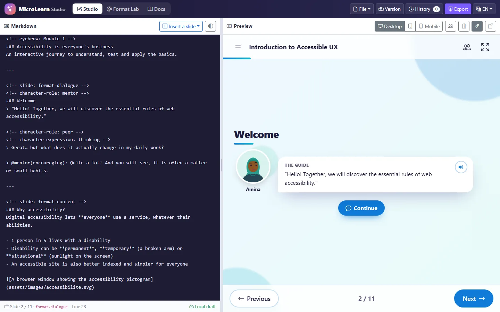
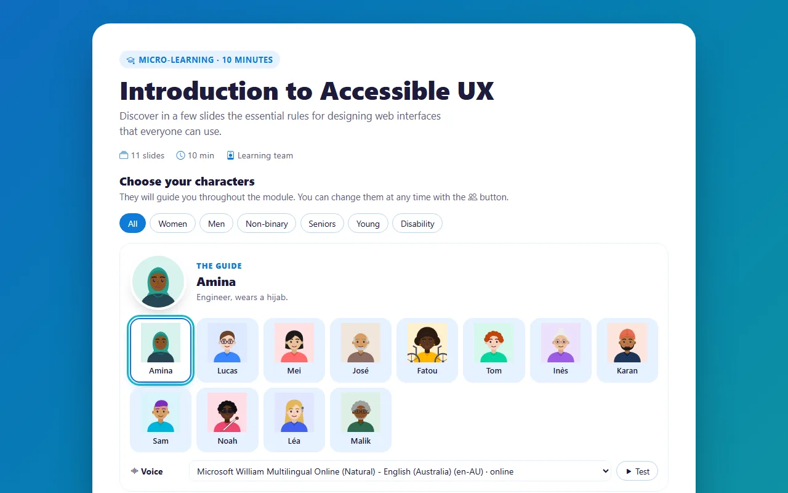
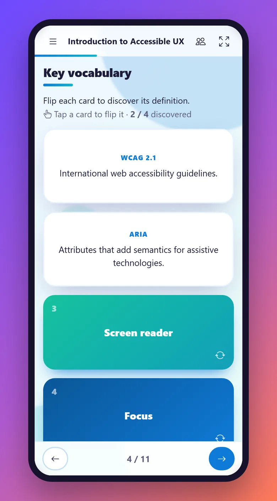
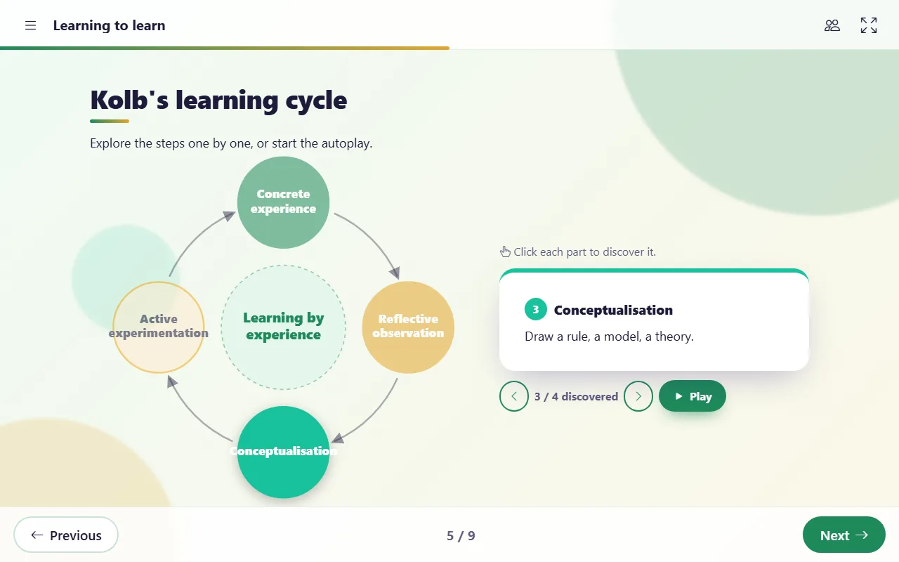
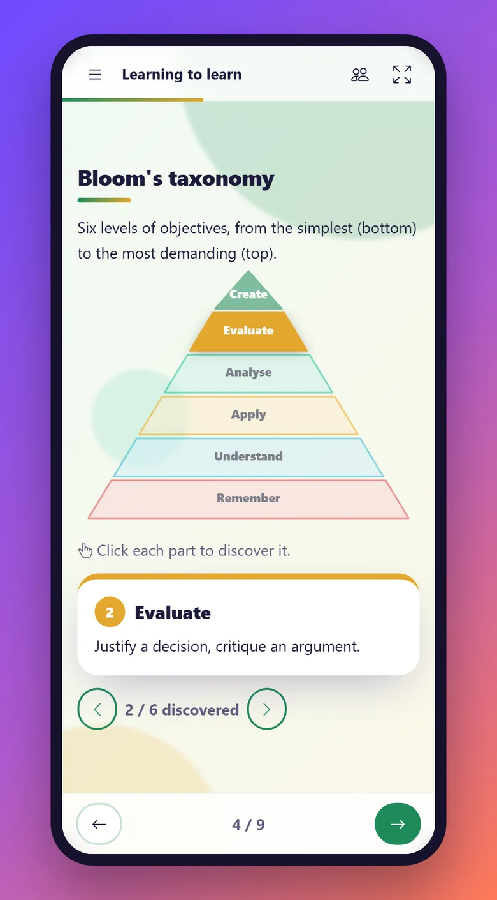

# MicroLearn Studio

[](https://doi.org/10.5281/zenodo.24464413)
Código fuente: [github.com/edu-fpar/micro-learning-app](https://github.com/edu-fpar/micro-learning-app)

[English](README.md) · [Français](README.fr.md) · **Español**

Convierte el material de tu curso en una **presentación interactiva y adaptable** (cuestionarios, tarjetas giratorias, líneas de tiempo, imágenes interactivas, diálogos entre personajes, esquemas interactivos…) y expórtala como un **paquete autónomo** que funciona sin conexión, en una memoria USB, en una intranet o en un LMS (SCORM 1.2). El curso se escribe como texto estructurado sencillo (Markdown), a mano o con cualquier IA.

100 % en el navegador · sin backend · sin compilación · sin CDN en ejecución · se puede alojar en GitHub Pages.

**▶ Pruébalo:** https://edu-fpar.github.io/micro-learning-app/ &nbsp;·&nbsp; [Documentación](https://edu-fpar.github.io/micro-learning-app/docs/?lang=es) &nbsp;·&nbsp; [Página para las IA](docs/skill-es.md)



---

## Funcionalidades

**Studio** (`index.html`): espacio de autoría
- Editor Markdown en directo con vista previa instantánea, sincronizada con la posición del cursor; arrastra y suelta un archivo `.md` para abrirlo
- Vista previa en escritorio / tableta / móvil
- Instantáneas de versiones e historial (guardados en el navegador)
- Avisos de formatos desconocidos, roles no declarados y numeración de módulos incoherente
- Exportación con un clic: carpeta **ZIP**, **archivo HTML único** o paquete **SCORM 1.2**

**Vista del alumnado** (`view.html`): la presentación sola, sin el Studio
- `view.html?c=1234` abre `courses/id_1234_<nombre>.md` (código corto para tus propios cursos publicados)
- `view.html?src=<url de un archivo .md>` abre un archivo Markdown a partir de su dirección
- Un **enlace para compartir** generado por el Studio contiene todo el curso, comprimido, en la URL (no se envía nada a ningún servidor)
- Sin parámetro: introduce un código o una dirección, suelta un archivo `.md` o elige un curso de la lista

**Format Lab** (`lab.html`): diseña tus propios formatos de diapositiva
- Cada formato = plantilla HTML + CSS + script + Markdown de ejemplo + textos FR/EN/ES
- Prueba en directo en escritorio y en móvil, en cada idioma
- Importación / exportación de formatos en JSON; los formatos personalizados se incluyen en las exportaciones

**Reproductor**: lo que ve el alumnado
- 9 formatos básicos: portada, contenido, diálogo entre personajes, consejo de un personaje, cuestionario (respuesta única o múltiple), tarjetas giratorias, línea de tiempo, pestañas/acordeón, imagen interactiva (puntos activos)
- 7 esquemas interactivos en **beta**: puzle para montar, pirámide, embudo, ciclo, proceso, matriz 2×2, concepto central, con una idea clave que se revela una vez exploradas todas las partes
- **Personajes elegidos por cada persona que aprende** entre un repertorio diverso (género, edad, origen, discapacidad), con 6 expresiones que reaccionan a las respuestas de los cuestionarios
- **Lectura en voz alta** con la síntesis de voz del navegador: una voz por personaje, control de velocidad, 4 modos (desactivada, con el icono, al abrir, automática). Es una herramienta de comodidad y no sustituye a los lectores de pantalla
- Cursos en varios módulos (progreso en el curso, módulo siguiente) y capítulos
- Interfaz en **francés, inglés y español** (según el campo `lang` del curso)
- Pensado para la accesibilidad: navegación con teclado, ARIA, gestión del foco, `prefers-reduced-motion`

<p align="center">
  
  &nbsp;
  
</p>
<p align="center">
  
  &nbsp;
  
</p>

## La sintaxis Markdown de un vistazo

```markdown
---
title: "Introducción a la UX accesible"
lang: es
theme: ocean
characters:
  mentor: "La Guía"
  peer: "El Compañero"
---

<!-- slide: format-dialogue -->
<!-- character-role: mentor -->
### Bienvenida
> ¡Hola! Vamos a descubrir las reglas esenciales de la accesibilidad web.

---

<!-- slide: format-flashcards -->
### Vocabulario clave
- **WCAG 2.1** :: Pautas internacionales de accesibilidad web.
- **ARIA** :: Atributos que añaden semántica para las tecnologías de apoyo.

---

<!-- slide: format-quiz -->
### ¿Qué atributo describe una imagen para los lectores de pantalla?
- [ ] title :: No se lee de forma fiable.
- [x] alt :: ¡Exacto!
```

Las diapositivas se separan con una línea `---`; cada diapositiva indica su formato con `<!-- slide: format-… -->`. Referencia completa: [docs/skill-es.md](docs/skill-es.md).

## Deja que una IA dé formato a tu curso

El profesorado no necesita aprender la sintaxis. Dale a cualquier IA (ChatGPT, Claude, Gemini, Mistral, Copilot…) la dirección de la página «skill» y tu contenido:

> Lee las instrucciones de https://edu-fpar.github.io/micro-learning-app/docs/skill-es.md y da formato al siguiente curso para MicroLearn: …

Versión francesa: [docs/skill.md](docs/skill.md); versión inglesa: [docs/skill-en.md](docs/skill-en.md). El archivo [`llms.txt`](llms.txt) de la raíz indica estas páginas a las IA.

## Primeros pasos

**En línea**: abre el enlace de GitHub Pages de arriba.

**En local**: sirve la carpeta con cualquier servidor web estático (la exportación necesita `http://`, no `file://`):

```bash
python -m http.server 8765
```

Después abre http://localhost:8765/. Sin instalación, sin `npm install`.

**Publica tu propia copia**: haz un fork del repositorio y activa GitHub Pages (rama `main`, carpeta raíz). El archivo `.nojekyll` hace que GitHub sirva las páginas «skill» en Markdown tal cual.

## Estructura del proyecto

```
index.html          Studio
view.html           Vista del alumnado (abre un curso por código, dirección de archivo o enlace compartido)
lab.html            Format Lab
player.html         Contenedor de vista previa (controlado por el Studio/Lab mediante postMessage)
courses/            Cursos publicados (id_<código>_<nombre>.md); una GitHub Action regenera index.json
.github/workflows/  courses-index.yml (índice automático de cursos)
docs/               Documentación (FR/EN/ES), páginas para las IA, formatos beta
css/                player.css (presentación), studio.css (Studio/Lab)
js/core/            Motor compartido con las exportaciones: parser, plantillas, reproductor, i18n, voz, esquemas, SCORM
js/formats/         Formatos de diapositiva integrados
js/studio/, js/lab/ Interfaces de autoría, generador de ZIP, exportador, cursos de ejemplo
assets/characters/  Repertorio de personajes (un SVG por expresión) + catalog.js
vendor/             Bootstrap 5.3, Bootstrap Icons 1.11, marked 12 (todo en local)
tools/              Scripts Node opcionales (índice de cursos, generador de avatares)
```

## Tecnologías

JavaScript puro, [marked](https://marked.js.org/) para el Markdown, [Bootstrap 5](https://getbootstrap.com/) y [Bootstrap Icons](https://icons.getbootstrap.com/), todo incluido en local para que las exportaciones funcionen sin conexión. Los esquemas interactivos se inspiran en [OpenNapkinAI](https://github.com/genaiwithshubham/opennapkinai) (MIT) y se generan de forma paramétrica en SVG.

## Estado

Prototipo temprano pero funcional. Los esquemas interactivos están en **beta**; las ilustraciones de personajes incluidas son provisionales y se sustituirán por una biblioteca abierta profesional.

## Licencia y cita

© 2026 François Parlant — [CC BY-NC-SA 4.0](https://creativecommons.org/licenses/by-nc-sa/4.0/). Su uso en clase o en formación es libre, citando al autor; las adaptaciones deben compartirse con la misma licencia. Ver [LICENSE](LICENSE).

**Uso comercial** (empresa de formación, editorial, marca blanca, escenarios a medida, paquetes SCORM personalizados): hay disponible una licencia comercial mediante acuerdo. [Ponte en contacto](https://edu-fpar.github.io/about.html?lang=en).

**Cómo citar** (botón *Cite this repository* de GitHub, a partir de [CITATION.cff](CITATION.cff)):

> Parlant, F. (2026). *MicroLearn Studio* [Educational software]. Zenodo. https://doi.org/10.5281/zenodo.24464413

¿Lo usas en clase? [Cuéntamelo](https://www.linkedin.com/in/francois-parlant/): estos comentarios me ayudan a mejorar la herramienta y a darla a conocer.
