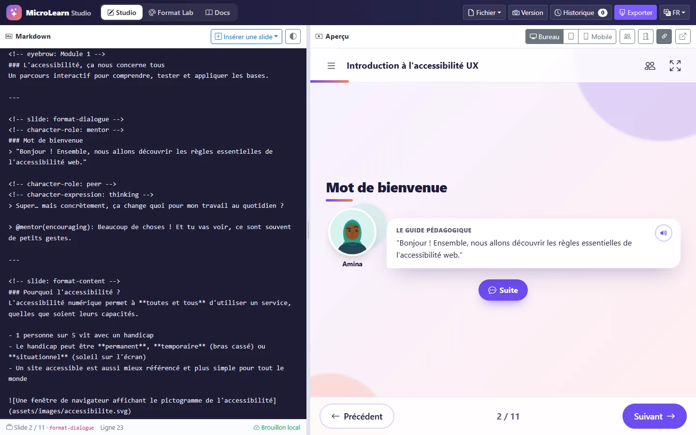
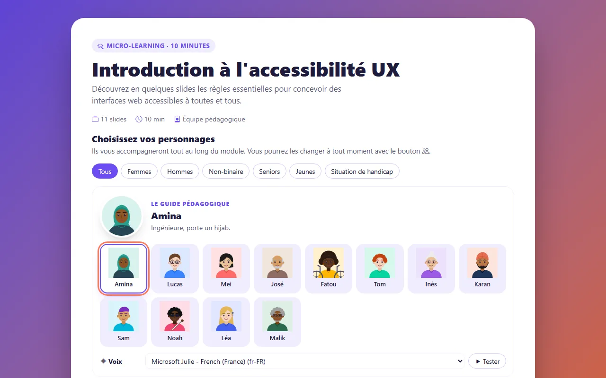
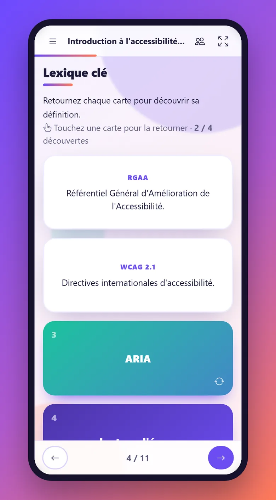
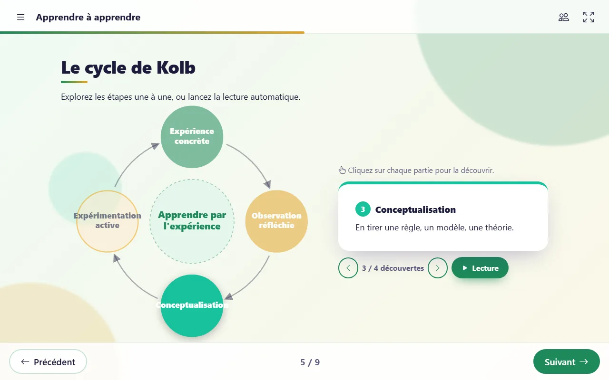
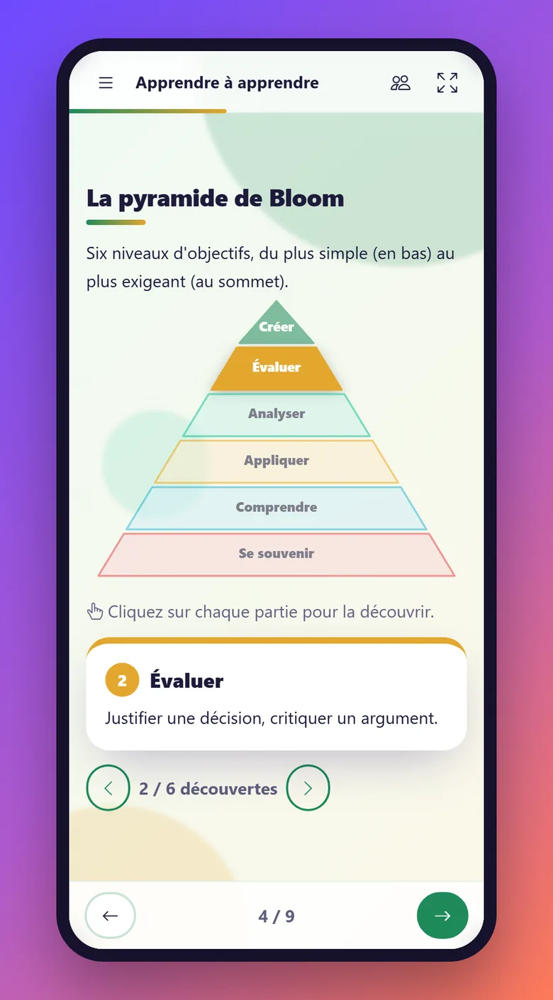

# MicroLearn Studio

[English](README.md) · **Français**

Transformez un cours écrit en Markdown structuré en **slideshow interactif et responsive** (quiz, cartes à retourner, frises, images interactives, dialogues avec personnages, schémas interactifs…) et exportez-le en **paquet autonome** qui fonctionne hors-ligne, sur clé USB, sur un intranet ou dans un LMS (SCORM 1.2).

100 % navigateur · sans serveur · sans étape de compilation · sans CDN à l'exécution · hébergeable sur GitHub Pages.

**▶ Essayer :** https://edu-fpar.github.io/micro-learning-app/ &nbsp;·&nbsp; [Documentation](https://edu-fpar.github.io/micro-learning-app/docs/?lang=fr) &nbsp;·&nbsp; [Page pour les IA](docs/skill.md)



---

## Fonctionnalités

**Studio** (`index.html`) : l'espace de rédaction
- Éditeur Markdown avec aperçu en direct, synchronisé avec la position du curseur ; glisser-déposer d'un fichier `.md` pour l'ouvrir
- Aperçu bureau / tablette / mobile
- Versions (« snapshots ») et historique, enregistrés dans le navigateur
- Avertissements : format inconnu, rôle non déclaré, numérotation de modules incohérente
- Export en un clic : dossier **ZIP**, **fichier HTML unique** ou paquet **SCORM 1.2**

**Vue apprenant** (`view.html`) : le diaporama seul, sans le Studio
- `view.html?c=1234` ouvre `courses/id_1234_<nom>.md` (code court pour vos propres cours publiés)
- `view.html?src=<adresse d'un fichier .md>` ouvre un fichier Markdown à partir de son adresse
- Un **lien de partage** généré par le Studio contient tout le cours, compressé, dans l'URL (rien n'est envoyé à un serveur)
- Sans paramètre : saisir un code ou une adresse, déposer un fichier `.md` ou choisir un cours dans la liste

**Format Lab** (`lab.html`) : créez vos propres formats de slides
- Un format = gabarit HTML + CSS + script + Markdown d'exemple + textes FR/EN
- Test en direct sur bureau et mobile, dans chaque langue
- Import / export des formats en JSON ; les formats personnalisés sont inclus dans les exports

**Player** : ce que voit l'apprenant
- 9 formats de base : couverture, contenu, dialogue, conseil d'un personnage, quiz (une ou plusieurs réponses), cartes à retourner, frise chronologique, onglets/accordéon, image interactive (points cliquables)
- 7 **schémas interactifs (bêta)** : puzzle à assembler, pyramide, entonnoir, cycle, processus, matrice 2×2, concept central. Une synthèse se révèle une fois toutes les parties explorées
- **Personnages choisis par l'apprenant** dans un répertoire varié (genre, âge, origine, handicap), avec 6 expressions qui réagissent aux réponses des quiz
- **Lecture à voix haute** par la synthèse vocale du navigateur : une voix par personnage, réglage de la vitesse, 4 modes (désactivée, sur l'icône, à l'ouverture, automatique). C'est un outil de confort, qui ne remplace pas les lecteurs d'écran
- Parcours en plusieurs modules (progression, module suivant) et chapitres
- Interface en **français et en anglais** (selon le champ `lang` du cours)
- Pensé pour l'accessibilité : navigation au clavier, ARIA, gestion du focus, `prefers-reduced-motion`

<p align="center">
  
  &nbsp;
  
</p>
<p align="center">
  
  &nbsp;
  
</p>

## La syntaxe en bref

```markdown
---
title: "Introduction à l'accessibilité UX"
lang: fr
theme: violet
characters:
  mentor: "Le Guide Pédagogique"
  peer: "Le Collègue"
---

<!-- slide: format-dialogue -->
<!-- character-role: mentor -->
### Mot de bienvenue
> Bonjour ! Ensemble, nous allons découvrir les règles essentielles de l'accessibilité web.

---

<!-- slide: format-flashcards -->
### Lexique clé
- **RGAA** :: Référentiel Général d'Amélioration de l'Accessibilité.
- **WCAG 2.1** :: Directives internationales d'accessibilité.

---

<!-- slide: format-quiz -->
### Quel attribut décrit une image pour les lecteurs d'écran ?
- [ ] title :: Pas restitué de façon fiable.
- [x] alt :: Exact !
```

Les slides sont séparées par une ligne `---` ; chaque slide indique son format avec `<!-- slide: format-… -->`. Référence complète : [docs/skill.md](docs/skill.md).

## Faire mettre son cours en forme par une IA

Pas besoin d'apprendre la syntaxe. Donnez à n'importe quelle IA (ChatGPT, Claude, Gemini, Mistral, Copilot…) l'adresse de la page « skill » et votre contenu :

> Lis les instructions sur https://edu-fpar.github.io/micro-learning-app/docs/skill.md et mets en forme le cours suivant pour MicroLearn : …

Version anglaise : [docs/skill-en.md](docs/skill-en.md). Le fichier [`llms.txt`](llms.txt) à la racine indique ces pages aux IA.

## Démarrer

**En ligne** : ouvrez le lien GitHub Pages ci-dessus.

**En local** : servez le dossier avec n'importe quel serveur web statique (l'export nécessite `http://`, pas `file://`) :

```bash
python -m http.server 8765
```

Puis ouvrez http://localhost:8765/. Aucune installation, pas de `npm install`.

**Publier votre propre copie** : faites un fork du dépôt et activez GitHub Pages (branche `main`, dossier racine). Le fichier `.nojekyll` permet à GitHub de servir les pages « skill » en Markdown brut.

## Structure du projet

```
index.html          Studio
view.html           Vue apprenant (ouvre un cours par code, adresse de fichier ou lien de partage)
lab.html            Format Lab
player.html         Coque d'aperçu (pilotée par le Studio/Lab via postMessage)
courses/            Cours publiés (id_<code>_<nom>.md) ; index.json est régénéré par une action GitHub
.github/workflows/  courses-index.yml (index automatique des cours)
docs/               Documentation (FR/EN), pages pour les IA, formats bêta
css/                player.css (slideshow), studio.css (Studio/Lab)
js/core/            Moteur partagé avec les exports : parseur, gabarits, player, i18n, voix, schémas, SCORM
js/formats/         Formats de slides intégrés
js/studio/, js/lab/ Interfaces d'édition, générateur ZIP, export, cours d'exemple
assets/characters/  Personnages (un SVG par expression) + catalog.js
vendor/             Bootstrap 5.3, Bootstrap Icons 1.11, marked 12 (tout en local)
tools/              Scripts Node facultatifs (index des cours, générateur d'avatars)
```

## Technologies

JavaScript sans framework, [marked](https://marked.js.org/) pour le Markdown, [Bootstrap 5](https://getbootstrap.com/) et [Bootstrap Icons](https://icons.getbootstrap.com/), tous copiés localement pour que les exports fonctionnent hors-ligne. Les schémas interactifs s'inspirent d'[OpenNapkinAI](https://github.com/genaiwithshubham/opennapkinai) (MIT) et sont générés en SVG de façon paramétrique.

## État du projet

Prototype jeune mais fonctionnel. Les schémas interactifs sont en **bêta** ; les illustrations de personnages fournies sont provisoires et seront remplacées par une bibliothèque libre professionnelle.
