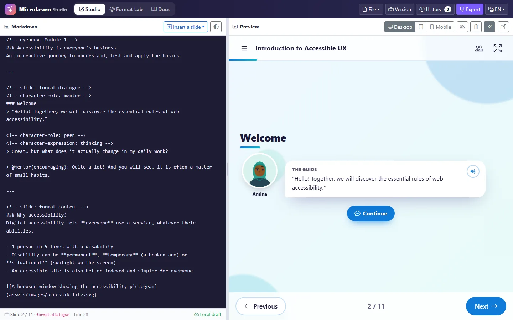
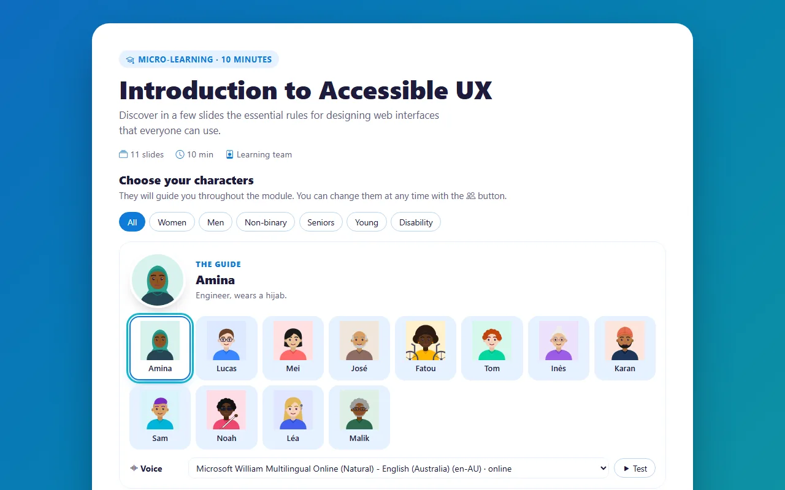
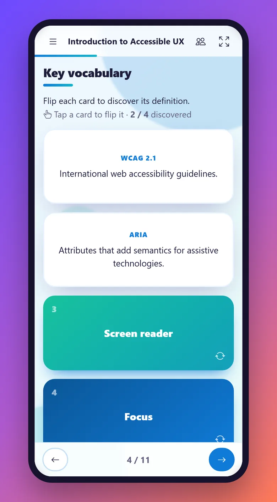
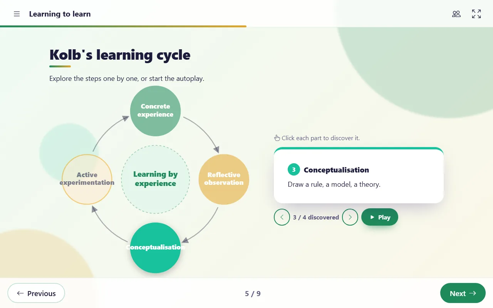
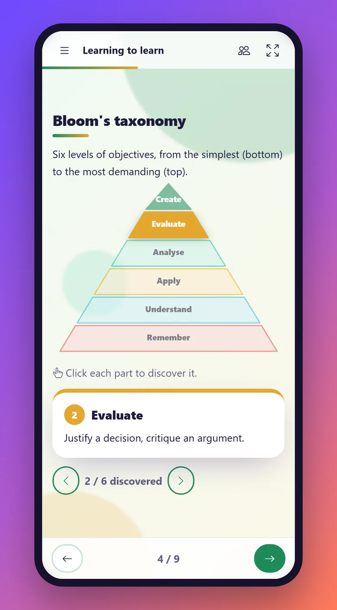

# MicroLearn Studio

**English** · [Français](README.fr.md)

Turn a structured Markdown course into an **interactive, responsive slideshow** (quizzes, flip cards, timelines, interactive images, character dialogues, interactive diagrams…) and export it as a **self-contained package** that works offline, on a USB stick, on an intranet or in an LMS (SCORM 1.2).

100% client-side · no backend · no build step · no CDN at runtime · hostable on GitHub Pages.

**▶ Try it:** https://fxpar.github.io/micro-learning-app/ &nbsp;·&nbsp; [Documentation](https://fxpar.github.io/micro-learning-app/docs/?lang=en) &nbsp;·&nbsp; [AI skill page](docs/skill-en.md)



---

## Features

**Studio** (`index.html`): authoring space
- Live Markdown editor with instant preview, synced with the cursor position
- Desktop / tablet / mobile preview
- Version snapshots and history (stored in the browser)
- Warnings for unknown formats, undeclared roles, inconsistent module numbering
- One-click export: **ZIP** folder, **single HTML file**, or **SCORM 1.2** package

**Format Lab** (`lab.html`): design your own slide formats
- Each format = HTML template + CSS + script + sample Markdown + FR/EN texts
- Live test on desktop and mobile, in each language
- Import / export formats as JSON; custom formats are embedded in exports

**Player**: what learners see
- 9 core formats: cover, content, character dialogue, character tip, quiz (single or multiple answers), flip cards, timeline, tabs/accordion, interactive image (hotspots)
- 7 **beta** interactive diagrams: puzzle to assemble, pyramid, funnel, cycle, process, 2×2 matrix, central concept, with a takeaway revealed once every part has been explored
- **Characters chosen by the learner** from a diverse set (gender, age, origin, disability), with 6 expressions that react to quiz answers
- **Read-aloud** with the browser's speech synthesis: a voice per character, speed control, 4 modes (off, icon, on open, automatic). It is a convenience tool and does not replace screen readers
- Courses in several modules (course progress, next module) and chapters
- Interface in **French and English** (driven by the course `lang`)
- Accessibility-minded: keyboard navigation, ARIA, focus management, `prefers-reduced-motion`

<p align="center">
  
  &nbsp;
  
</p>
<p align="center">
  
  &nbsp;
  
</p>

## Markdown syntax at a glance

```markdown
---
title: "Introduction to Accessible UX"
lang: en
theme: ocean
characters:
  mentor: "The Guide"
  peer: "The Colleague"
---

<!-- slide: format-dialogue -->
<!-- character-role: mentor -->
### Welcome
> Hello! Together, we will discover the essential rules of web accessibility.

---

<!-- slide: format-flashcards -->
### Key vocabulary
- **WCAG 2.1** :: International web accessibility guidelines.
- **ARIA** :: Attributes that add semantics for assistive technologies.

---

<!-- slide: format-quiz -->
### Which attribute describes an image for screen readers?
- [ ] title :: Not read reliably.
- [x] alt :: Exactly!
```

Slides are separated by a `---` line; each slide declares its format with `<!-- slide: format-… -->`. Full reference: [docs/skill-en.md](docs/skill-en.md).

## Let an AI format your course

Teachers don't need to learn the syntax. Give any AI (ChatGPT, Claude, Gemini, Mistral, Copilot…) the address of the skill page and your content:

> Read the instructions at https://fxpar.github.io/micro-learning-app/docs/skill-en.md and format the following course for MicroLearn: …

French version: [docs/skill.md](docs/skill.md). The [`llms.txt`](llms.txt) file at the root points AIs to these pages.

## Getting started

**Online**: open the GitHub Pages link above.

**Locally**: serve the folder with any static web server (exporting needs `http://`, not `file://`):

```bash
python -m http.server 8765
```

Then open http://localhost:8765/. No installation, no `npm install`.

**Publish your own copy**: fork the repository and enable GitHub Pages (branch `main`, root folder). The `.nojekyll` file makes GitHub serve the Markdown skill pages as-is.

## Project structure

```
index.html          Studio
lab.html            Format Lab
player.html         Preview shell (driven by the Studio/Lab through postMessage)
docs/               Documentation (FR/EN), AI skill pages, beta formats
css/                player.css (slideshow), studio.css (Studio/Lab)
js/core/            Engine shared with exports: parser, templates, player, i18n, speech, diagrams, SCORM
js/formats/         Built-in slide formats
js/studio/, js/lab/ Authoring interfaces, ZIP writer, exporter, sample courses
assets/characters/  Character set (SVG per expression) + catalog.js
vendor/             Bootstrap 5.3, Bootstrap Icons 1.11, marked 12 (all local)
tools/              Optional dev script (avatar generator, Node)
```

## Tech stack

Vanilla JavaScript, [marked](https://marked.js.org/) for Markdown, [Bootstrap 5](https://getbootstrap.com/) and [Bootstrap Icons](https://icons.getbootstrap.com/), all vendored locally so that exports work offline. The interactive diagrams are inspired by [OpenNapkinAI](https://github.com/genaiwithshubham/opennapkinai) (MIT) and generated parametrically in SVG.

## Status

Early but functional prototype. The interactive diagrams are in **beta**; the bundled character illustrations are placeholders and will be replaced by a professional open library.
